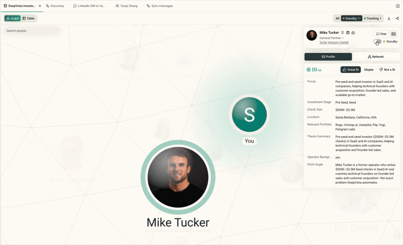
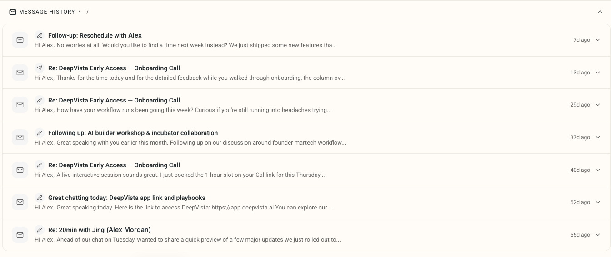
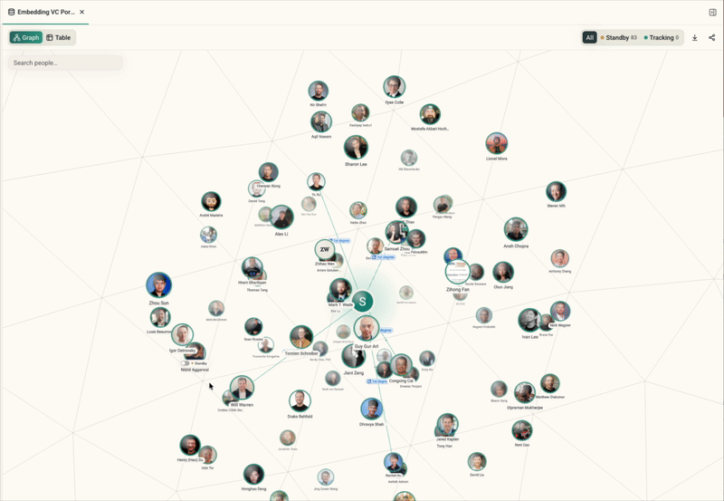

October 30, 2026

Cold pitches to reporters, executives, investors, and partners almost always get ignored. This release helps you find a warm path first, and keeps you in control of who your agent contacts.

#### **1. Your agent waits until you say go: Standby vs. Tracking**

- Every contact from a discovery workflow or a fresh import now lands in **Standby**. Inspect their background, past work, and company details without triggering any background sequences.
- Once a prospect belongs in your pipeline, set their status to **Tracking**. Only **Tracking** contacts are eligible for daily workflows, research updates, and outreach generation.
- Toggle the tracker header between **All**, **Standby**, and **Tracking** at any time.

Try it by clicking any person's avatar in your tracker, opening their profile, and setting them to **Tracking**.

#### **2. Gmail and LinkedIn replies, synced every day**

- A daily background sweep checks your connected Gmail and LinkedIn accounts.
- Any reply or message from a tracked contact in the past 24 hours logs to their person card. No more toggling between Gmail, Sales Navigator, and CRM notes.

Try it by opening a contact you've been messaging and checking the **Message History** tab.

#### **3. Spot the warm intro before you send a cold pitch**

- The relationship graph now tags your direct LinkedIn connections with a **1st degree** badge.
- A direct line traces from each one back to **You**, so you can see who can make the intro without digging through mutual connections.

Try it by opening **Graph** view on your tracker, clicking a prospect you want to meet, and checking which 1st-degree connections can introduce you.
